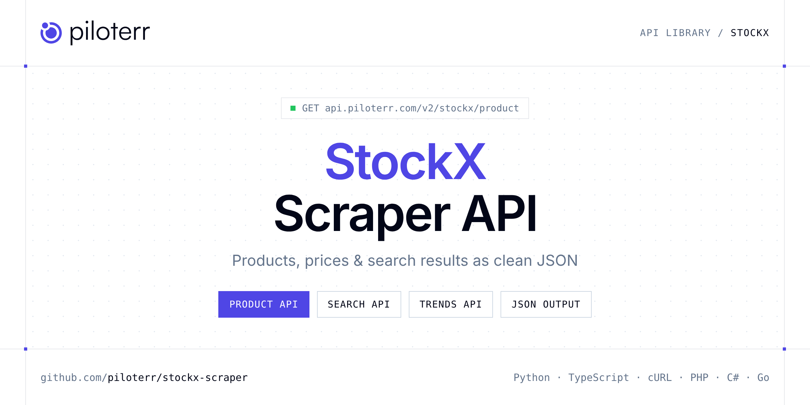

<p align="center">
  <a href="https://www.piloterr.com"></a>
</p>

# StockX Scraper API

[](https://discord.gg/CFj3ph8aHU) [](https://app.piloterr.com) [](https://app.piloterr.com/openapi) [](LICENSE)

The **Piloterr StockX Scraper API** lets you extract public data from StockX as **clean, structured JSON** — no proxies, headless browsers or HTML parsing to maintain. Endpoints available in production:

- **StockX Product API** — Retrieve detailed product information from StockX, including market prices, bid/ask data, size variants, and product metadata.
- **StockX Search API** — Search StockX for products by name, brand, SKU, or slug and receive a list of matching items with product IDs, slugs, images, and colorways.
- **StockX Trends API** — Retrieve trending products on StockX by category, with options to sort by featured, most active, or release date.

Use it for price monitoring, assortment tracking, competitor analysis, product research or catalog enrichment.

| Endpoint | Path | Credits | What you get |
|---|---|---|---|
| [StockX Product API](#stockx-product-api) | `/v2/stockx/product` | 2 | Retrieve detailed product information from StockX, including market prices, bid/ask data, size variants, and product metadata. |
| [StockX Search API](#stockx-search-api) | `/v2/stockx/search` | 2 | Search StockX for products by name, brand, SKU, or slug and receive a list of matching items with product IDs, slugs, images, and colorways. |
| [StockX Trends API](#stockx-trends-api) | `/v2/stockx/trends` | 2 | Retrieve trending products on StockX by category, with options to sort by featured, most active, or release date. |

## Table of contents

- [How it works](#how-it-works)
- [StockX Product API](#stockx-product-api)
- [StockX Search API](#stockx-search-api)
- [StockX Trends API](#stockx-trends-api)
- [Code examples in other languages](#code-examples-in-other-languages)
- [Practical use cases](#practical-use-cases)
- [Why Piloterr?](#why-piloterr)
- [FAQ](#faq)
- [Official SDKs](#official-sdks)
- [Related scrapers](#related-scrapers)
- [Support](#support)

## How it works

1. **Create a free Piloterr account** and copy your API key from the [dashboard](https://app.piloterr.com).
2. **Send a `GET` (or `POST`) request** to `https://api.piloterr.com/v2/...` with the header `x-api-key: YOUR_API_KEY`.
3. **Receive structured JSON** — Piloterr handles rendering, proxies, retries and parsing.

```bash
export PILOTERR_API_KEY="your-api-key"
pip install requests        # Python
# TypeScript: Node.js 18+ (native fetch), run with `npx tsx file.ts`
```

> Every endpoint accepts both `GET` (query string) and `POST` (JSON body with the same fields).

## StockX Product API

Retrieve detailed product information from StockX, including market prices, bid/ask data, size variants, and product metadata.

`GET | POST https://api.piloterr.com/v2/stockx/product` · **2 credits per request** · [Full reference](https://app.piloterr.com/openapi)

### Request parameters

| Parameter | Type | Required | Description |
|---|---|---|---|
| `query` | string | ✅ | A StockX product slug. |
| `country` | string | — | Country code for localized pricing and availability. |
| `currency` | string | — | Currency code for price display. |
| `language` | string | — | Language code for localized content. |

### Python example

```python
import json
import os
import requests

response = requests.get(
    "https://api.piloterr.com/v2/stockx/product",
    headers={"x-api-key": os.environ["PILOTERR_API_KEY"]},
    params={
        "query": "nike-air-max-1-travis-scott-wheat",
    },
    timeout=120,
)
response.raise_for_status()
data = response.json()

print(json.dumps(data, indent=2, ensure_ascii=False)[:2000])
```

### TypeScript example

```typescript
type StockxProduct = {
  id?: string;
  sku?: string;
  name?: string;
  slug?: string;
  brand?: string;
  image?: string;
  model?: string;
  gender?: string;
  market?: {
    bids?: {
      lowest_ask?: number;
      highest_bid?: number;
      number_asks?: number;
      number_bids?: number;
    };
    sales?: {
      last_sale?: number;
      change_value?: number;
      sales_last_72h?: number;
      change_percentage?: number;
    };
    shipping?: {
      standard?: Record<string, unknown>;
      express_next_day?: Record<string, unknown>;
      express_standard?: Record<string, unknown>;
      express_expedited?: Record<string, unknown>;
    };
  };
  traits?: {
    name?: string;
    value?: string;
  }[];
  category?: string;
  variants?: {
    id?: string;
    gtins?: {
      type?: string;
      identifier?: string;
    }[];
    sizes?: {
      size?: string;
      type?: string;
    }[];
    market?: {
      bids?: Record<string, unknown>;
      sales?: Record<string, unknown>;
      shipping?: Record<string, unknown>;
    };
    traits?: {
      size?: string;
    };
  }[];
  breadcrumbs?: {
    url?: string;
    name?: string;
    level?: number;
  }[];
  description?: string;
  small_image?: string;
  thumb_image?: string;
  primary_category?: string;
};

const params = new URLSearchParams({
  "query": "nike-air-max-1-travis-scott-wheat",
});

const response = await fetch(`https://api.piloterr.com/v2/stockx/product?${params}`, {
  headers: { "x-api-key": process.env.PILOTERR_API_KEY! },
});
if (!response.ok) throw new Error(`Piloterr error ${response.status}: ${await response.text()}`);

const data = (await response.json()) as StockxProduct;

console.log(JSON.stringify(data, null, 2).slice(0, 2000));
```

<details>
<summary><b>POST variant</b></summary>

```http
POST https://api.piloterr.com/v2/stockx/product
x-api-key: YOUR_API_KEY
Content-Type: application/json

{"query": "nike-air-max-1-travis-scott-wheat"}
```
</details>

### Output example

Example response from the API reference, abridged — real values depend on the page you scrape.

```json
{
  "id": "c318bbcc-312a-4396-9252-698c203d1dea",
  "sku": "DO9392-700",
  "name": "Nike Air Max 1 Travis Scott Cactus Jack Saturn Gold",
  "slug": "nike-air-max-1-travis-scott-wheat",
  "brand": "Nike",
  "image": "https://images.stockx.com/images/Nike-Air-Max-1-Travis-Scott-Wheat-Product.jpg?fit=fill&bg=FFFFFF&w=700&h=500&fm=webp&auto=compress&q=90&…",
  "model": "Nike Air Max 1",
  "gender": "men",
  "market": {
    "bids": {
      "lowest_ask": 168,
      "highest_bid": 270,
      "number_asks": 373,
      "number_bids": 272
    },
    "sales": {
      "last_sale": 303,
      "change_value": -7,
      "sales_last_72h": 6,
      "change_percentage": -0.0231
    },
    "shipping": {
      "standard": {
        "count": 373,
        "lowest_ask": 168,
        "inventory_type": null,
        "latest_delivery_date": null,
        "expected_delivery_date": null
      },
      "express_next_day": {
        "count": 5,
        "lowest_ask": 170,
        "inventory_type": "CUSTODIAL",
        "latest_delivery_date": "2026-06-03T21:00:00.000Z",
        "expected_delivery_date": "2026-06-03T21:00:00.000Z"
      },
      "express_standard": {
        "count": 30,
        "lowest_ask": 168,
        "inventory_type": "DFS",
        "latest_delivery_date": "2026-06-09T21:00:00.000Z",
        "expected_delivery_date": "2026-06-04T21:00:00.000Z"
      },
      "express_expedited": {
        "count": 5,
        "lowest_ask": 170,
        "inventory_type": "CUSTODIAL",
        "latest_delivery_date": "2026-06-04T21:00:00.000Z",
        "expected_delivery_date": "2026-06-04T21:00:00.000Z"
      }
    }
  },
  "traits": [
    {
      "name": "Style",
      "value": "DO9392-700"
    },
    {
      "name": "Colorway",
      "value": "Saturn Gold/Tea Tree Mist/Tent"
    }
  ],
  "category": "sneakers",
  "variants": [
    {
      "id": "c7e40ad8-030e-4444-baaf-30569c52347b",
      "gtins": [
        {}
      ],
      "sizes": [
        {},
        {}
      ],
      "market": {
        "bids": {},
        "sales": {},
        "shipping": {}
      },
      "traits": {
        "size": "4"
      }
    }
  ],
  "breadcrumbs": [
    {
      "url": "/",
      "name": "Home",
      "level": 1
    },
    {
      "url": "/sneakers",
      "name": "sneakers",
      "level": 2
    }
  ],
  "description": "In collaboration with Travis Scott's record label Cactus Jack, the Nike Air Max 1 Travis Scott Cactus Jack Saturn Gold pays homage to out…",
  "small_image": "https://images.stockx.com/images/Nike-Air-Max-1-Travis-Scott-Wheat-Product.jpg?fit=fill&bg=FFFFFF&w=300&h=214&fm=webp&auto=compress&q=90&…",
  "thumb_image": "https://images.stockx.com/images/Nike-Air-Max-1-Travis-Scott-Wheat-Product.jpg?fit=fill&bg=FFFFFF&w=140&h=100&fm=webp&auto=compress&q=90&…",
  "primary_category": "Air Max"
}
```

### Response fields

| Field | Type | Description |
|---|---|---|
| `id` | string |  |
| `sku` | string |  |
| `name` | string |  |
| `slug` | string |  |
| `brand` | string |  |
| `image` | string |  |
| `model` | string |  |
| `gender` | string |  |
| `market` | object |  |
| `market.bids` | object |  |
| `market.sales` | object |  |
| `market.shipping` | object |  |
| `traits[]` | object[] |  |
| `traits[].name` | string |  |
| `traits[].value` | string |  |
| `category` | string |  |
| `variants[]` | object[] |  |
| `variants[].id` | string |  |
| `variants[].gtins[]` | object[] |  |
| `variants[].sizes[]` | object[] |  |
| `variants[].market` | object |  |
| `variants[].traits` | object |  |
| `breadcrumbs[]` | object[] |  |
| `breadcrumbs[].url` | string |  |
| `breadcrumbs[].name` | string |  |

## StockX Search API

Search StockX for products by name, brand, SKU, or slug and receive a list of matching items with product IDs, slugs, images, and colorways.

`GET | POST https://api.piloterr.com/v2/stockx/search` · **2 credits per request** · [Full reference](https://app.piloterr.com/openapi)

### Request parameters

| Parameter | Type | Required | Description |
|---|---|---|---|
| `query` | string | ✅ | Search query for StockX products. Can be a product name, brand, SKU, or slug. |

### Python example

```python
import json
import os
import requests

response = requests.get(
    "https://api.piloterr.com/v2/stockx/search",
    headers={"x-api-key": os.environ["PILOTERR_API_KEY"]},
    params={
        "query": "Air Jordan Retro",
    },
    timeout=120,
)
response.raise_for_status()
data = response.json()

print(json.dumps(data, indent=2, ensure_ascii=False)[:2000])
```

### TypeScript example

```typescript
type StockxSearch = {
  id?: string;
  sku?: unknown;
  name?: string;
  slug?: string;
  brand?: string;
  image?: string;
  category?: string;
  colorway?: string;
}[];

const params = new URLSearchParams({
  "query": "Air Jordan Retro",
});

const response = await fetch(`https://api.piloterr.com/v2/stockx/search?${params}`, {
  headers: { "x-api-key": process.env.PILOTERR_API_KEY! },
});
if (!response.ok) throw new Error(`Piloterr error ${response.status}: ${await response.text()}`);

const data = (await response.json()) as StockxSearch;

console.log(JSON.stringify(data, null, 2).slice(0, 2000));
```

<details>
<summary><b>POST variant</b></summary>

```http
POST https://api.piloterr.com/v2/stockx/search
x-api-key: YOUR_API_KEY
Content-Type: application/json

{"query": "Air Jordan Retro"}
```
</details>

### Output example

Example response from the API reference, abridged — real values depend on the page you scrape.

```json
[
  {
    "id": "9acafeb5-bc4a-4d66-bc3a-4899d2e64775",
    "sku": null,
    "name": "Jordan 4 Retro",
    "slug": "air-jordan-4-retro-toro-bravo-2026",
    "brand": "Jordan",
    "image": "https://images.stockx.com/images/Air-Jordan-4-Retro-Toro-Bravo-2026-Product.jpg?fit=fill&bg=FFFFFF&w=140&h=100&fm=webp&auto=compress&q=90…",
    "category": "sneakers",
    "colorway": "Toro Bravo (2026)"
  },
  {
    "id": "019c8c79-5739-7557-8d1f-4825eb64694d",
    "sku": null,
    "name": "Jordan 4 Retro OG",
    "slug": "air-jordan-4-retro-og-nigel-sylvester-brick-after-brick",
    "brand": "Jordan",
    "image": "https://images.stockx.com/images/Air-Jordan-4-Retro-OG-Nigel-Sylvester-Sail-Cinnabar-Product.jpg?fit=fill&bg=FFFFFF&w=140&h=100&fm=webp&a…",
    "category": "sneakers",
    "colorway": "Nigel Sylvester Brick After Brick"
  }
]
```

### Response fields

| Field | Type | Description |
|---|---|---|

## StockX Trends API

Retrieve trending products on StockX by category, with options to sort by featured, most active, or release date.

`GET | POST https://api.piloterr.com/v2/stockx/trends` · **2 credits per request** · [Full reference](https://app.piloterr.com/openapi)

### Request parameters

| Parameter | Type | Required | Description |
|---|---|---|---|
| `query` | string | ✅ | StockX product category to retrieve trending items for. |
| `sort_by` | string | — | Sort order for trending results. |
| `country` | string | — | Country code for localized trending data. |

### Python example

```python
import json
import os
import requests

response = requests.get(
    "https://api.piloterr.com/v2/stockx/trends",
    headers={"x-api-key": os.environ["PILOTERR_API_KEY"]},
    params={
        "query": "sneakers",
    },
    timeout=120,
)
response.raise_for_status()
data = response.json()

print(json.dumps(data, indent=2, ensure_ascii=False)[:2000])
```

### TypeScript example

```typescript
type StockxTrends = {
  id?: string;
  sku?: string;
  name?: string;
  slug?: string;
  brand?: string;
  image?: string;
  category?: string;
  release_date?: string;
}[];

const params = new URLSearchParams({
  "query": "sneakers",
});

const response = await fetch(`https://api.piloterr.com/v2/stockx/trends?${params}`, {
  headers: { "x-api-key": process.env.PILOTERR_API_KEY! },
});
if (!response.ok) throw new Error(`Piloterr error ${response.status}: ${await response.text()}`);

const data = (await response.json()) as StockxTrends;

console.log(JSON.stringify(data, null, 2).slice(0, 2000));
```

<details>
<summary><b>POST variant</b></summary>

```http
POST https://api.piloterr.com/v2/stockx/trends
x-api-key: YOUR_API_KEY
Content-Type: application/json

{"query": "sneakers"}
```
</details>

### Output example

Example response from the API reference, abridged — real values depend on the page you scrape.

```json
[
  {
    "id": "6693bae8-39f1-4809-a6a3-b26c91a7aa5a",
    "sku": "1J30-291-025/1J30-191-025",
    "name": "A Bathing Ape Bape SK8 Sta Grey Gold White",
    "slug": "a-bathing-ape-bape-sk8-sta-grey-gold-white",
    "brand": "bape",
    "image": "https://images.stockx.com/images/A-Bathing-Ape-Bape-SK8-Sta-Grey-Gold-White.jpg",
    "category": "sneakers",
    "release_date": "2023-04-14"
  },
  {
    "id": "0b450075-9f93-4423-8677-4d8029ff7348",
    "sku": "DZ5485-612",
    "name": "Jordan 1 Retro High OG Chicago 2022",
    "slug": "air-jordan-1-high-og-chicago-2022",
    "brand": "Jordan",
    "image": "https://images.stockx.com/images/Air-Jordan-1-Retro-High-OG-Chicago-2022.jpg",
    "category": "sneakers",
    "release_date": "2023-05-06"
  }
]
```

### Response fields

| Field | Type | Description |
|---|---|---|

## Code examples in other languages

Ready-to-run examples live in the [`examples/`](examples) folder. Each one reads your key from the `PILOTERR_API_KEY` environment variable.

| Language | Product | Search | Trends |
|---|---|---|---|
| cURL (Bash) | [`product`](examples/curl/product.sh) | [`search`](examples/curl/search.sh) | [`trends`](examples/curl/trends.sh) |
| PHP | [`product`](examples/php/product.php) | [`search`](examples/php/search.php) | [`trends`](examples/php/trends.php) |
| C# | [`product`](examples/csharp/Product.cs) | [`search`](examples/csharp/Search.cs) | [`trends`](examples/csharp/Trends.cs) |
| Go | [`product`](examples/go/product.go) | [`search`](examples/go/search.go) | [`trends`](examples/go/trends.go) |
| Java | [`product`](examples/java/ProductExample.java) | [`search`](examples/java/SearchExample.java) | [`trends`](examples/java/TrendsExample.java) |
| Ruby | [`product`](examples/ruby/product.rb) | [`search`](examples/ruby/search.rb) | [`trends`](examples/ruby/trends.rb) |
| Node.js | [`product`](examples/nodejs/product.mjs) | [`search`](examples/nodejs/search.mjs) | [`trends`](examples/nodejs/trends.mjs) |

## Practical use cases

- **Price monitoring** — Track prices, promotions and availability over time to react to competitors.
- **Assortment & catalog tracking** — Follow new products, delisted items and category changes.
- **Competitor analysis** — Benchmark ranges, brands and positioning across retailers.
- **Product research** — Spot best-sellers and trends from search results.
- **Catalog enrichment** — Pull titles, images and attributes into your PIM or marketplace listings.

## Why Piloterr?

- **No infrastructure** — no proxies, headless browsers or CAPTCHA solving to run yourself.
- **Structured JSON** — stable, documented fields instead of brittle HTML selectors.
- **Pay per request** — transparent credit cost per endpoint, failed requests are retried for you.
- **One API key, hundreds of sources** — StockX plus many other e-commerce, search and company data endpoints in the [Piloterr library](https://www.piloterr.com/library).
- **Any language** — plain HTTPS + JSON, with examples for Python, TypeScript, cURL, PHP, C#, Go, Java, Ruby and Node.js.

## FAQ

### Is it legal to scrape StockX?

Collecting publicly available data is generally allowed in many jurisdictions, but rules depend on your country, the data you collect and how you use it. Avoid personal data unless you have a lawful basis, respect the website's terms where they apply, and get legal advice for your specific use case. This is not legal advice.

### Do I need proxies or a headless browser?

No. Piloterr handles rendering, proxy rotation and retries on its side. You only send an HTTPS request with your `x-api-key` header and receive JSON.

### How much does a request cost?

Credits per call: `/v2/stockx/product` **2**, `/v2/stockx/search` **2**, `/v2/stockx/trends` **2**. See the [Piloterr website](https://www.piloterr.com) for plans.

### What data does the StockX API return?

Each endpoint returns structured JSON: **StockX Product** — `id`, `sku`, `name`, `slug`, `brand`, `image`; **StockX Search** — see the reference; **StockX Trends** — see the reference.

### Can I target a specific country or language?

Yes, use `country`, `language` — see the parameter tables above for accepted values.

### Which languages are supported?

Any language that can make an HTTP request. This README shows Python and TypeScript; the [`examples/`](examples) folder contains cURL, PHP, C#, Go, Java, Ruby and Node.js.

## Official SDKs

Use Piloterr from your own language with a typed client:

| SDK | Package | Install |
| --- | --- | --- |
| Node.js | [`@piloterr/sdk`](https://www.npmjs.com/package/@piloterr/sdk) | `npm install @piloterr/sdk` |
| Python | [`piloterr`](https://pypi.org/project/piloterr/) | `pip install piloterr` |
| Go | [`piloterr-go`](https://pkg.go.dev/github.com/piloterr/piloterr-go) | `go get github.com/piloterr/piloterr-go` |
| .NET | [`Piloterr`](https://www.nuget.org/packages/Piloterr) | `dotnet add package Piloterr` |
| Ruby | [`piloterr`](https://rubygems.org/gems/piloterr) | `gem install piloterr` |
| PHP | [`piloterr/sdk`](https://packagist.org/packages/piloterr/sdk) | `composer require piloterr/sdk` |
| Java | [`piloterr-java`](https://github.com/piloterr/piloterr-java) | build from source, see its README |
| CLI | [`@piloterr/cli`](https://www.npmjs.com/package/@piloterr/cli) | `npm install -g @piloterr/cli` |
| MCP server | [`@piloterr/mcp`](https://www.npmjs.com/package/@piloterr/mcp) | `npx -y @piloterr/mcp` |

## Related scrapers

- [About You Scraper API](https://github.com/piloterr/aboutyou-scraper)
- [Action Scraper API](https://github.com/piloterr/action-scraper)
- [Aldi Scraper API](https://github.com/piloterr/aldi-scraper)
- [Alibaba Scraper API](https://github.com/piloterr/alibaba-scraper)
- [AliExpress Scraper API](https://github.com/piloterr/aliexpress-scraper)
- [Allegro Scraper API](https://github.com/piloterr/allegro-scraper)
- [All Piloterr scrapers on GitHub](https://github.com/piloterr)

## Support

- 💬 Join the [Piloterr Discord](https://discord.gg/CFj3ph8aHU) to ask questions and share what you build.
- 📚 Browse the [API reference (OpenAPI)](https://app.piloterr.com/openapi) and the [Piloterr library](https://www.piloterr.com/library).
- 🔑 [Get your API key](https://app.piloterr.com).

---

<p align="center">
  <a href="https://www.piloterr.com">
    <picture>
      <source media="(prefers-color-scheme: dark)" srcset="images/logo-dark.svg">
      
    </picture>
  </a>
  <br>
  <sub>Built by <a href="https://www.piloterr.com">Piloterr</a> — web scraping APIs for e-commerce, search, real estate and more, one API key.</sub>
</p>

<sub>StockX is a trademark of its respective owner. This repository is not affiliated with or endorsed by StockX. Examples are released under the MIT license.</sub>
